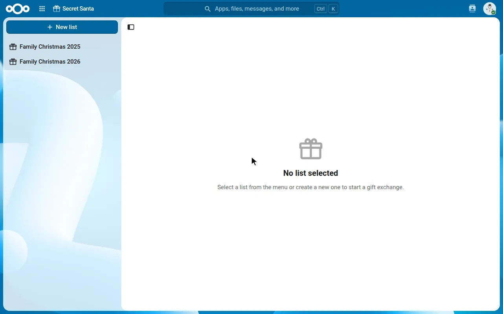

<!--
  - SPDX-FileCopyrightText: 2026 Ferdinand Thiessen <opensource@fthiessen.de>
  - SPDX-License-Identifier: AGPL-3.0-or-later
-->

# 🧑‍🎄 Secret Santa

Organize a Secret Santa gift exchange ("Wichteln") in Nextcloud.



- Create lists of participants, both Nextcloud users and guests by name and email
- Write the email every participant receives
- Draw the partners and notify every participant by email whom to give a gift
- Exclude partners, e.g. couples, from drawing each other
- Import the partners of an earlier draw, so nobody draws the same partner again
- Archive the lists of past gift exchanges, they are hidden from the navigation and can no longer be changed
- Share lists with groups to organize the gift exchange together

The [user guide](docs/user-guide.md) explains how to organize a gift exchange step by step.

Emails are sent through the mail server configured in the Nextcloud administration settings.
Every user who can use the app can send emails with their own text to the participants, including guests.
Administrators can limit the app to some groups in the app management.

Lists can be shared with groups, following the sharing settings of the server (e.g. sharing only with the own groups).
All members of the groups can change the list and draw the partners, only the owner can delete and share it.
If the owner is deleted, their shared lists are kept without owner.

## Development

```sh
composer install
npm ci
npm run dev
```

- PHP: `composer run cs:check`, `composer run psalm`, `composer run test:unit`
- Frontend: `npm run lint`, `npm run stylelint`, `npm test`
- End-to-end: `npm run playwright` starts a Nextcloud container with the app (Docker required, uses port 8089), run `npm run playwright:install` once before
- API: `composer run openapi` regenerates `openapi.json` after changing a controller or `lib/ResponseDefinitions.php`
- Screenshots: `npm run screenshots` regenerates the app store screenshots in `docs/screenshots` with the same container as the end-to-end tests, the animated demo needs `img2webp` from libwebp

### Tests

The unit tests (`tests/unit`) need a Nextcloud installation with the app enabled, the app has to be placed in an apps directory of that installation.
Run them with `composer run test:unit`, set `NEXTCLOUD_CONFIG_DIR` to use another configuration than the default one of the server.

The integration tests (`tests/integration`) send requests to a running instance with the app enabled.
They create and delete their own users with the admin account, configured by environment variables:

| Variable | Default |
| --- | --- |
| `NEXTCLOUD_URL` | `http://localhost:8080` |
| `NEXTCLOUD_ADMIN_USER` | `admin` |
| `NEXTCLOUD_ADMIN_PASSWORD` | `admin` |

```sh
NEXTCLOUD_URL=http://localhost:8089 composer run test:integration
```

The tests that check the partners sent by email need [MailHog](https://github.com/mailhog/MailHog) and are skipped without it.
Configure the instance to send its emails to the SMTP server of MailHog and set `MAILHOG_URL` to its web interface,
e.g. `MAILHOG_URL=http://localhost:8025`.

### Translations

The app is translated manually, see the
[developer documentation](https://docs.nextcloud.com/server/stable/developer_manual/app_development/translation.html#manual-translation).
This requires gettext and the translation tool from [nextcloud/docker-ci](https://github.com/nextcloud/docker-ci/tree/master/translations/translationtool).
Run all commands from the app folder, which has to be named `secret_santa`:

1. Extract the strings into the template `translationfiles/templates/secret_santa.pot`:
   ```sh
   php /path/to/translationtool.phar create-pot-files
   sed -i "s#$(pwd)/#secret_santa/#g" translationfiles/templates/secret_santa.pot
   ```
2. Merge the new strings into the translation of a language, e.g. German:
   ```sh
   msgmerge --update --backup=none translationfiles/de/secret_santa.po translationfiles/templates/secret_santa.pot
   ```
   To add a new language, create `translationfiles/<lang>/secret_santa.po` with `msginit` instead.
3. Translate the strings in the `.po` file, e.g. with [Poedit](https://poedit.net).
   Review entries marked as fuzzy and remove obsolete entries.
   `msgfmt --check -o /dev/null translationfiles/de/secret_santa.po` reports format errors.
4. Generate the `l10n/<lang>.js` and `l10n/<lang>.json` files used by Nextcloud:
   ```sh
   php /path/to/translationtool.phar convert-po-files
   ```

Commit the template, the `.po` files and the generated `l10n` files.
