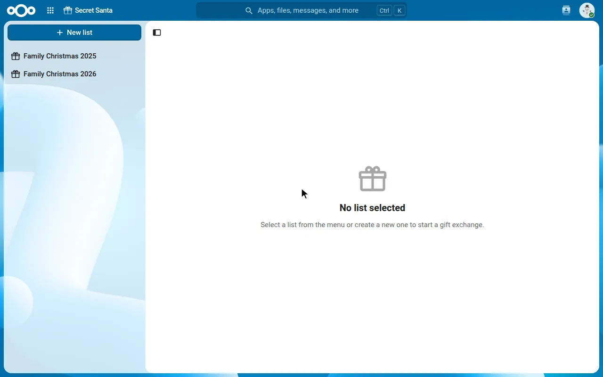
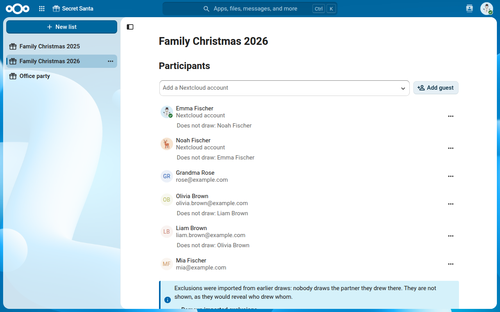
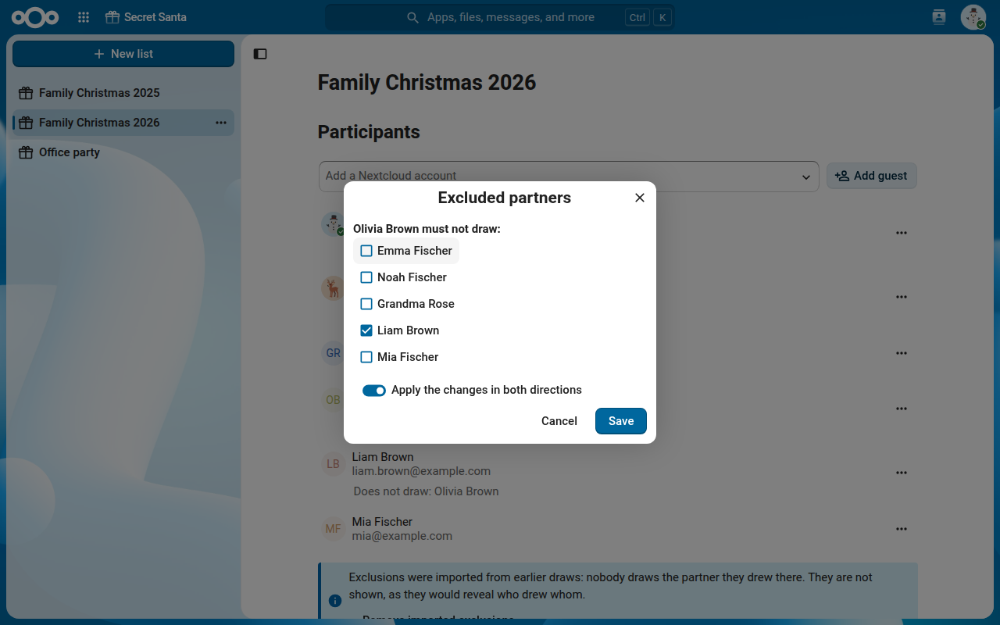
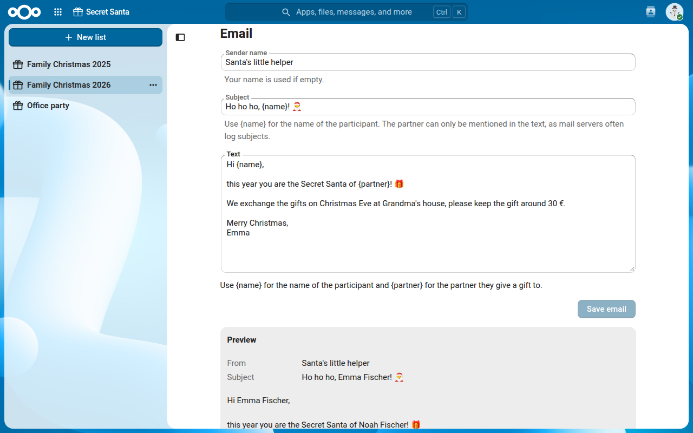
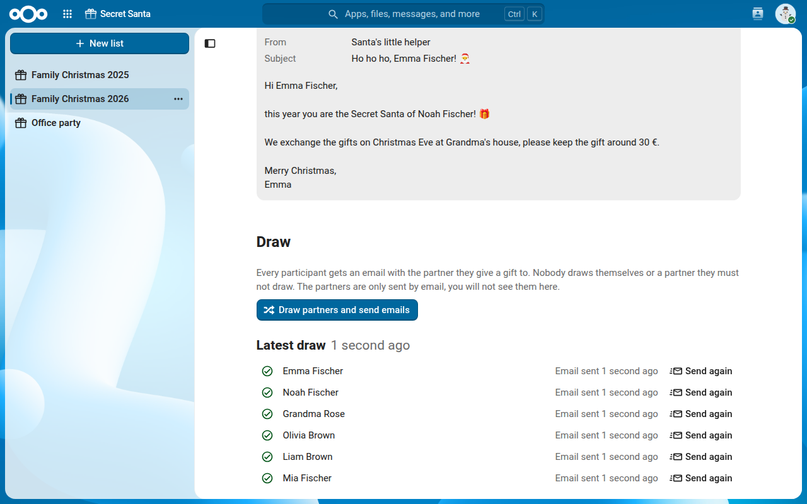

<!--
  - SPDX-FileCopyrightText: 2026 Ferdinand Thiessen <opensource@fthiessen.de>
  - SPDX-License-Identifier: AGPL-3.0-or-later
-->

# Secret Santa user guide

Secret Santa organizes a gift exchange: every participant draws another participant and gives them a gift.
The app draws the partners for you and tells every participant by email whom they give a gift to.
Nobody sees the drawn partners in the app, not even the organizer.

A gift exchange takes four steps:

1. [Create a list](#create-a-list) for the gift exchange.
2. [Add the participants](#add-participants), Nextcloud accounts and guests.
3. Optionally [exclude partners](#exclude-partners), e.g. couples, and [write the email](#write-the-email).
4. [Draw the partners](#draw-the-partners): every participant gets an email with their partner.

## Create a list

Open **Secret Santa** in the app menu and click **New list** in the navigation.
Enter a name, e.g. "Christmas party", and click **Create list**.

The navigation shows your lists under **Your lists**, lists of others under **Shared with you**.
Open the menu of a list in the navigation to **Rename**, **Archive** or **Delete** it.

## Add participants

A list has two kinds of participants:

- **Nextcloud accounts:** search for the account in **Add a Nextcloud account**.
  The app uses the name and email address of the account, so they always stay up to date.
  You can only add accounts you could share files with, e.g. only members of your own groups if the administrator restricted sharing.
- **Guests:** click **Add guest** and enter their name and email address.
  Change them later with **Edit** in the menu of the guest.

Every participant needs an email address to receive their partner.
Accounts without email address are marked "No email address, can not be notified".
Ask them to add one in their personal settings before you draw the partners.

Remove a participant with **Remove** in their menu.
A list can have up to 100 participants, and no two guests can use the same email address.

## Exclude partners

Some participants should not draw each other, for example couples or people who live together.
Open the menu of a participant, click **Partners not to draw** and select the participants they must not draw.

With **Apply the changes in both directions** switched on (the default), the selected participants also must not draw this participant.
Switch it off to exclude only one direction.
The list of participants shows the exclusions as "Does not draw: …".

Every exclusion makes the draw harder.
If too many partners are excluded, the app can not draw the partners and asks you to remove exclusions or add participants.

### Avoid the partners of last year

Nobody wants to draw the same partner as last year.
Click **Import exclusions** below the participants and select a list, e.g. the gift exchange of last year or the current list itself.
Nobody then draws the partner they drew in the latest draw of that list.
Participants are matched by their Nextcloud account or email address, participants who are not on both lists are ignored.

The imported exclusions are not shown, as they would reveal who drew whom.
The list only notes that exclusions were imported.
Import again after adding participants, and click **Remove imported exclusions** to remove them all.

## Write the email

Every participant gets an email with their partner.
The **Email** section of the list contains a default text, change it as you like:

- **Sender name:** the name the email is sent from. Your name is used if it is empty.
- **Subject:** use `{name}` for the name of the participant.
  The partner can not be mentioned in the subject, as mail servers often log the subjects of emails.
- **Text:** use `{name}` for the name of the participant and `{partner}` for the partner they give a gift to.

The **Preview** shows the email with example names.
Click **Save email** to save your changes.

The email is sent from the email address of the Nextcloud server.
If you have an email address in your personal settings, replies to the email are sent to you.

## Draw the partners

Click **Draw partners and send emails** in the **Draw** section and confirm.
The app draws a partner for every participant and sends the emails:

- Nobody draws themselves or a partner they must not draw.
- No two participants draw each other.
- The draw needs at least 3 participants, and every participant needs an email address.
- If only one draw is possible with these participants and exclusions, everybody could find out who drew whom.
  The app refuses such a draw, add participants or remove exclusions.

You never see the drawn partners, they are only sent by email.
**Latest draw** lists every participant with "Email sent" or "Email not sent".

### Send an email again

If a participant did not receive their email, deleted it, or the email could not be sent, click **Send again** next to the participant.
They get the same partner again.

To send the email to another address, change the email address of the guest (or ask the account owner to change theirs) and click **Send again**.

### Draw again

Click **Draw partners and send emails** again to draw new partners, e.g. after adding participants.
All participants get an email with a new partner, the emails of the previous draw are no longer valid.
Tell the participants about it, so they do not buy a gift for their old partner.
The dates of earlier draws are listed under **Previous draws**.

If you remove a participant after the draw, their partner has nobody to give a gift to anymore.
The app then asks you to draw the partners again, and the emails of the latest draw can no longer be sent again.

To prevent misuse, you can draw at most 5 times and send at most 20 emails again per hour.

## Organize together

Share a list with groups to organize the gift exchange together.
Search for a group in **Share with a group** in the **Sharing** section of the list.

All members of the groups can change the list, add participants and draw the partners.
Only the owner of the list can delete and share it.
Stop sharing with a group with the button next to the group.

If the owner of a shared list is deleted, the list is kept for the members of the groups.
To delete or share such a list, a member clicks **Take over list** in the **Sharing** section and becomes its new owner.
The emails are then sent with the name of the new owner, unless the list has its own sender name, and replies go to their email address.

## Archive a list

After the gift exchange, archive the list to hide it from the navigation:
open the menu of the list in the navigation and click **Archive**.

Archived lists can not be changed, but their partners can still be [imported as exclusions](#avoid-the-partners-of-last-year) into other lists.
Click **Archived lists** in the navigation to see them, and **Unarchive** to change a list again.

## Delete a list

Open the menu of the list and click **Delete**.
This deletes the list with all participants and draws and can not be undone.
Delete archived lists in **Archived lists**.

## For administrators

- The app sends emails through the mail server configured in **Administration settings** → **Basic settings**.
  Use **Send email** there to test the configuration.
- Every user who can use the app can send emails with their own text to any email address.
  Limit the app to some groups in the app management if needed.
- The sharing settings of the server apply: e.g. if users can only share with their own groups,
  they can only add accounts and share lists within their groups.
